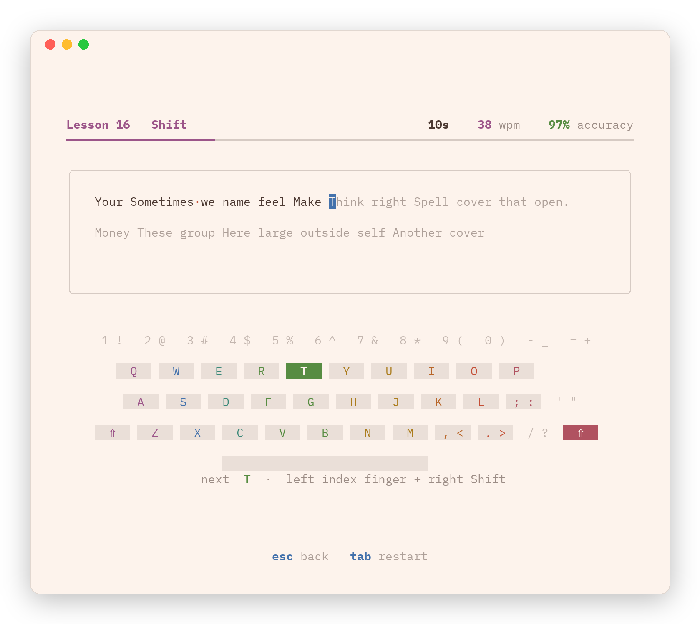
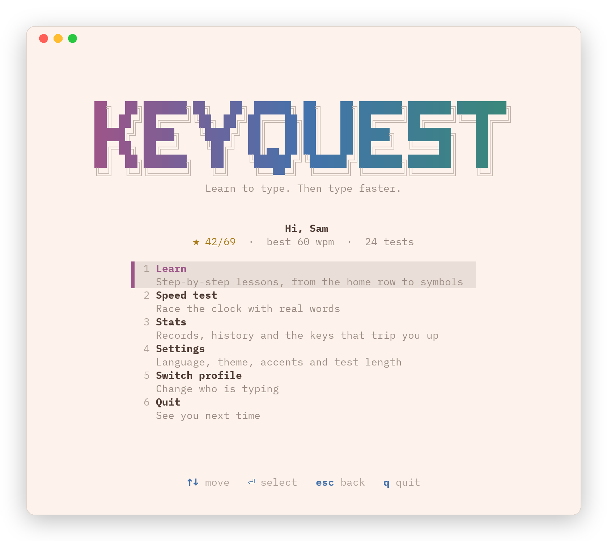
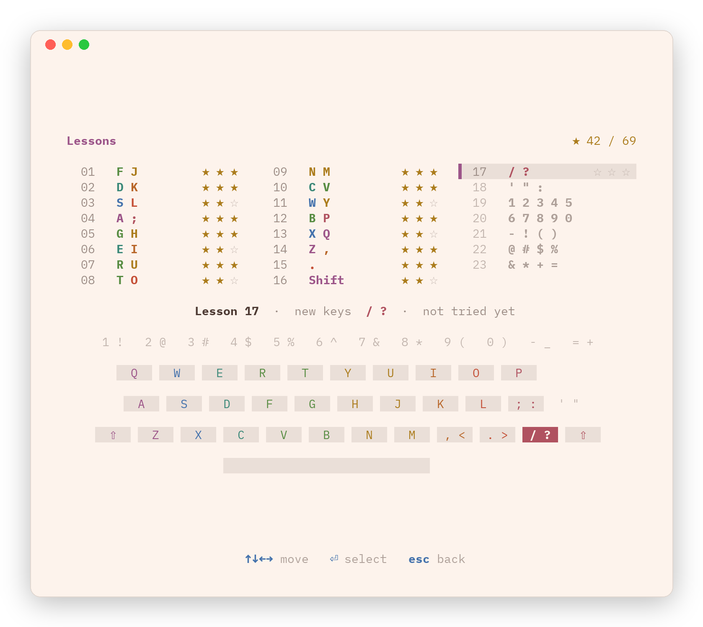
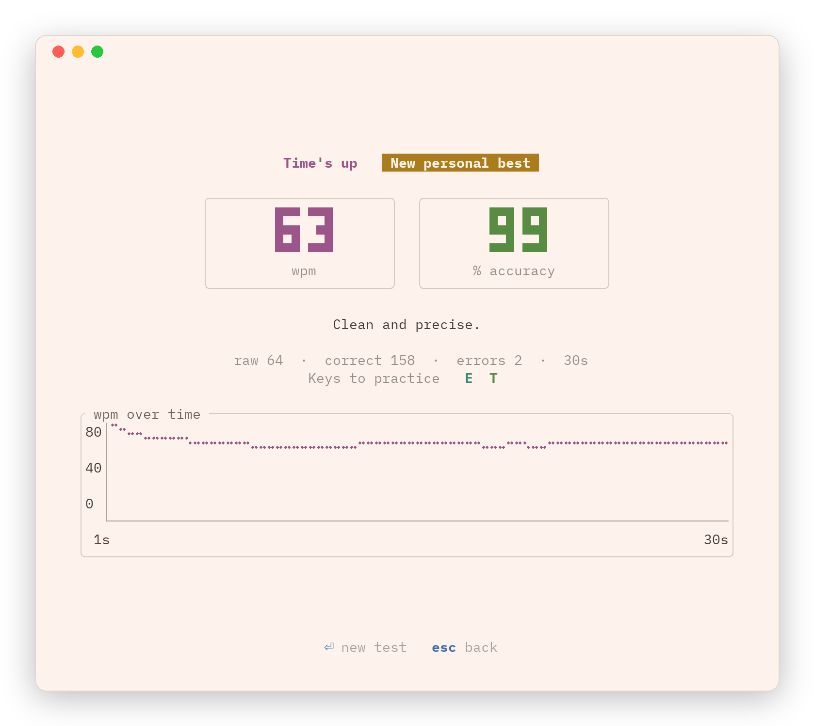
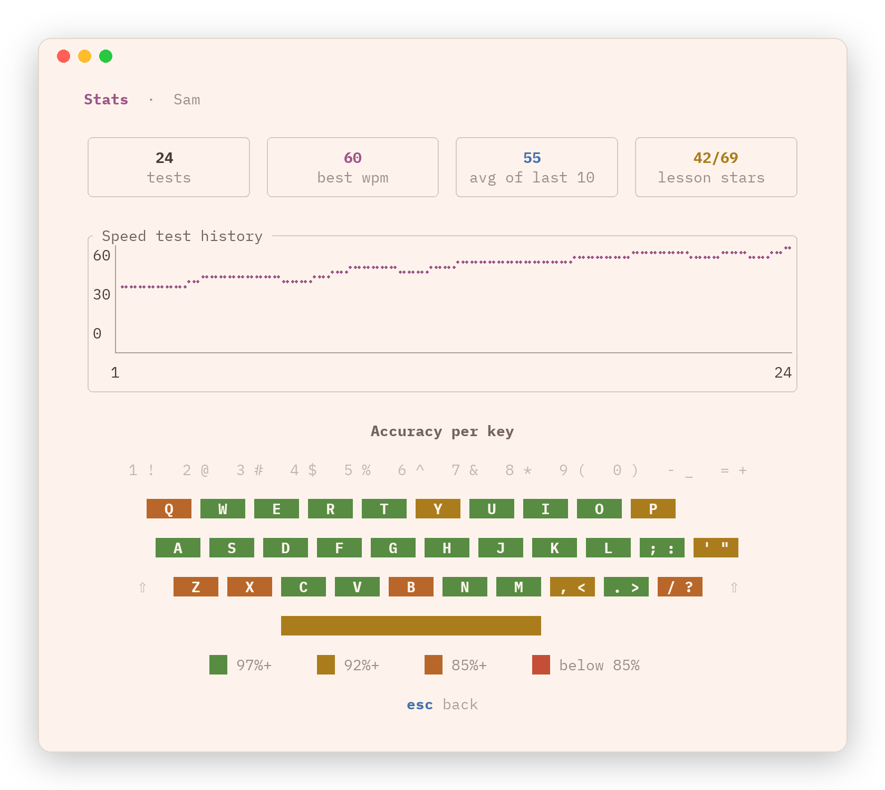
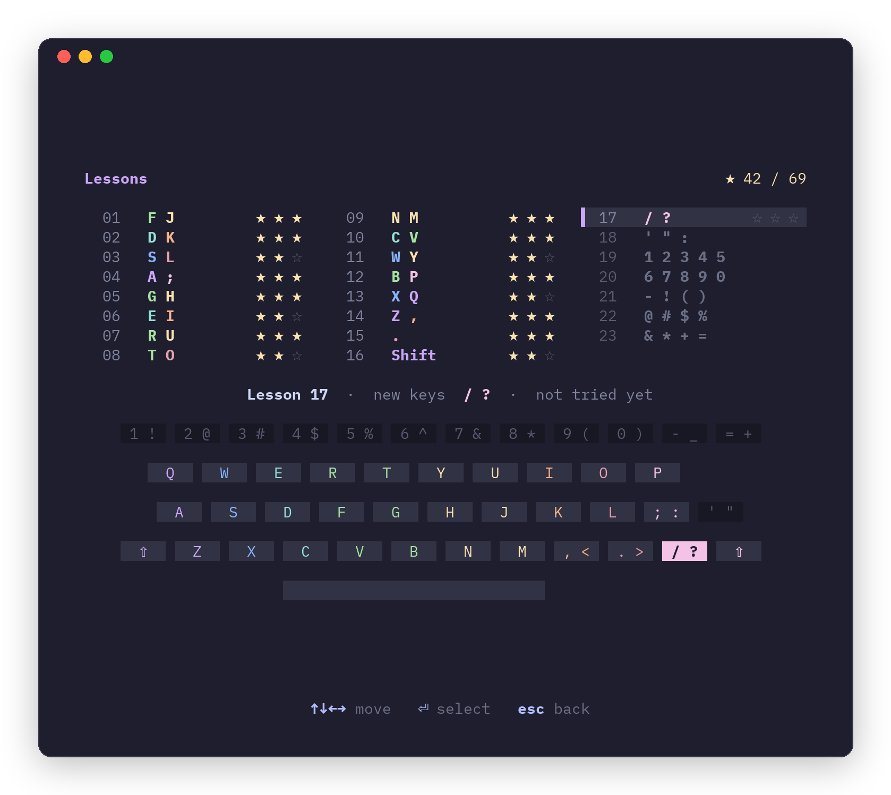

# keyquest

Learn to type. Then type faster.

A terminal typing tutor for any age. Step-by-step lessons teach touch typing from the home row to numbers and symbols, and timed speed tests track how fast you get. It speaks English and Brazilian Portuguese, and it picks up your terminal's colors.



## Features

- **23 lessons** that start on the home row and work up to capitals, punctuation, numbers and symbols, with an on-screen keyboard that shows which finger (and which Shift) to use
- **Speed tests** with real words, in 15, 30, 60 or 120 seconds
- **Stats**: personal bests, a history chart and accuracy per key, so you know what to practice
- **Profiles**, so everyone in the house keeps their own progress
- **English and Português (Brasil)**, for menus, lessons and word lists
- **Matches your terminal theme**, or use the built-in Catppuccin palette

## Screenshots

<table>
  <tr>
    <td></td>
    <td></td>
  </tr>
  <tr>
    <td></td>
    <td></td>
  </tr>
</table>

## Themes

The default **Terminal** theme asks your terminal for its colors and builds the palette from them, so keyquest looks at home on light and dark themes alike. Terminals that don't answer get the standard ANSI colors. Prefer a fixed look? Switch to **Catppuccin** in Settings.

<table>
  <tr>
    <td></td>
    <td></td>
  </tr>
  <tr>
    <td align="center">Terminal (on a light theme)</td>
    <td align="center">Catppuccin</td>
  </tr>
</table>

## Install

You need [Rust](https://rustup.rs) 1.88 or newer.

```sh
git clone https://github.com/vmrocha/keyquest
cd keyquest
cargo install --path .
keyquest
```

Or run it without installing: `cargo run --release`.

## How it works

### Lessons

| Lessons | New keys |
| --- | --- |
| 1 to 4 | Home row: `F J`, `D K`, `S L`, `A ;` |
| 5 | `G H` |
| 6 to 8 | Top row: `E I`, `R U`, `T O` |
| 9 to 10 | Bottom row: `N M`, `C V` |
| 11 to 15 | The rest: `W Y`, `B P`, `X Q`, `Z ,`, `.` |
| 16 | `Shift` for capitals |
| 17 to 18 | Punctuation: `/ ?`, `' " :` |
| 19 to 20 | Numbers: `1 2 3 4 5`, `6 7 8 9 0` |
| 21 to 23 | Symbols: `- ! ( )`, `@ # $ %`, `& * + =` |

Each lesson only uses keys you have learned so far. Capitals and symbols use the Shift key on the other hand, and the keyboard lights up both keys. Accuracy earns stars: 85% for one star (and the next lesson), 93% for two, 98% for three.

### Keys

| Key | Action |
| --- | --- |
| `↑` `↓` (or `j` `k`) | Move |
| `⏎` | Select |
| `1` to `6` | Jump to a menu item |
| `tab` | Restart the lesson or test |
| `←` `→` | Change the test length before you start typing |
| `ctrl+w` or `alt+backspace` | Delete the last word |
| `n` / `d` | New or delete a profile, on the profile screen |
| `esc` | Back |
| `q` | Quit, from the main menu |

### Settings

- **Language**: English or Português (Brasil)
- **Accents**: Exact needs the accent; Relaxed accepts the plain letter, so `a` works for `á`
- **Speed test length**: 15, 30, 60 or 120 seconds
- **Keyboard in speed tests**: show or hide the on-screen keyboard
- **Theme**: Terminal or Catppuccin

## Your data

Profiles and progress are saved to a JSON file:

- macOS: `~/Library/Application Support/keyquest/profiles.json`
- Linux: `~/.local/share/keyquest/profiles.json`

Set `KEYQUEST_DATA` to use a different file, for example to try things out without touching your progress:

```sh
KEYQUEST_DATA=/tmp/keyquest.json keyquest
```
